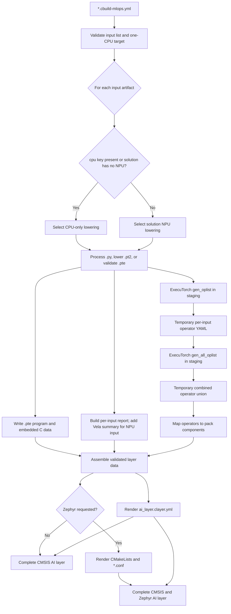
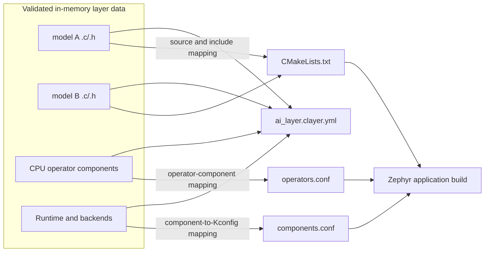
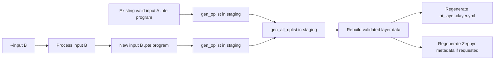

# TODO for Template Release

- Update CMSIS-Toolbox to version 2.16 once available.

- DONE: Expand support to both Zephyr-based and CMSIS-based workflows.

- DONE: Add Cortex-M-only targets alongside the existing Cortex-M/Ethos-U targets.

- Final directory structure should be:

  | Directory | Scope | Contents |
  | --- | --- | --- |
  | `cmsis-u55` | CMSIS Cortex-M/U55/U65 | Solution, layers, config |
  | `cmsis-u85` | CMSIS Cortex-M/U85 | Solution, layers, config |
  | `cmsis-m` | CMSIS Cortex-M | Solution, layers, config |
  | `zephyr-u55` | Zephyr Cortex-M/U55/U65 | Solution, app, config |
  | `zephyr-u85` | Zephyr Cortex-M/U85 | Solution, app, config |
  | `zephyr-m` | Zephyr Cortex-M | Solution, app, config |
  | `model_conversion` | Shared model-conversion tools | Scripts and tests |
  | `.venv` | Shared Python environment | Python packages (not part of the repo) |
  | `model` | Shared model sources | One subdirectory per ML model |

# TODO for ExecuTorch compiler diagnostics

## Goal

Review ExecuTorch sources for correctness and portability, minimize warnings through
source fixes, and document remaining CMSIS/Zephyr configuration needs.

- Review existing `cproject.yml` suppressions; they hide findings documented in
  `et-warnings.md` without validating numerical, ABI, or portability impact.

Reference: [Compiler diagnostics](../cmsis-et-issues/et-warnings.md)

## ExecuTorch 1.6.0 Release

### Pack

- Add Zephyr integration folder; use generation script to generate the files.
- Apply fix for AC6 crash in `op_quantize.cpp`.
- Apply fix `<stddef.h>`/`<cstddef>` in `tag.h`; remove the `-include stddef.h` workaround.

### Zephyr Templates

- Add specific warning controls to minimize warnings; make it target-specific (for CMSIS-NN, Executorch); avoid global Zephyr suppressions.

## ExecuTorch 1.7.0

### Apply ExecuTorch sources changes

- Replace deprecated `optional` aliases; remove `-Wno-deprecated-declarations` from CMSIS and Zephyr templates.
- Find operators requiring IEEE NaN/Inf behavior, test them, or configure AC6 full FP compliance, and remove `-Wno-nan-infinity-disabled`.
- Fix mixed float/double expressions in quantize/dequantize; retain `-Wdouble-promotion` during qualification.
- Validate negative sizes and use consistent size types; retain `-Wall`/`-Wsign-compare`.
- Move or instantiate LLVM-reported unused header helpers; do not add global `-Wno-unused-function`.
- Fix the AC6 `op_quantize.cpp` crash, test all optimization levels on AC6 and LLVM.
- Verify GCC C++ ABI compatibility; retain scoped `-Wno-psabi` only when the informational note cannot be eliminated.
- Include `<stddef.h>`/`<cstddef>` in `tag.h`; remove the `-include stddef.h` workaround.
- Fix the CMSIS-NN MVE intrinsic type mismatch; remove scoped  `-Wno-incompatible-pointer-types`.

## Zephyr Integration issues

- Fix duplicate `libethosu_core_driver.a` emission in Zephyr's ArmClang link command.
- Fix orphan sections and RWX segments with explicit linker placement and permissions; never suppress these warnings.
- Ensure each `<name>_pte.c` belongs to Zephyr `app` exactly once; never use weak definitions to hide duplicate symbols.

## Template configuration

- CMSIS: put temporary controls in `project.misc` with `for-compiler`; keep FP-mode choices separate from diagnostic suppressions.
- Zephyr: use target/source `target_compile_options` with language/compiler expressions; do not mute application or unrelated modules.
- Every warning suppression needs scope, reason, owner, upstream issue, removal condition, and CMSIS/Zephyr documentation.

## DONE: AI Input

Use these terms for the `create_ai_layer` interface:

- **Input artifact**: a file supplied through `model.input`. It is a container
  boundary, not necessarily a single model, and may represent one model or
  several named models or programs. A quantized `.pt2` archive still requires
  backend lowering; a `.pte` is a candidate prebuilt program container that
  must already be backend-lowered; and a `.py` file uses the convenience
  workflow to define or load a `torch.nn.Module`, supply its example and
  calibration inputs, and still requires export, quantization, and backend
  lowering.
- **Output program artifact**: a deployment-ready `.pte` produced or accepted
  by `create_ai_layer`. It is backend-lowered for, and validated against, the
  selected target. It may contain portable CPU fallback operators.
- **AI layer**: the generated `*.clayer.yml` and its integrated output program
  artifacts, C arrays, dependency metadata, reports, and optional Zephyr files.
  It targets exactly one CPU, optionally with Ethos-U acceleration. Every
  `.pte` in the AI layer satisfies the output-program invariant above and is
  compatible with that CPU and, when used, its Ethos-U configuration.

A typical flow is:

```text
.py workflow
    -> instantiate or load a PyTorch model (torch.nn.Module)
    -> provide example and calibration inputs
    -> torch.export to an ExportedProgram
    -> quantize and validate the model
    -> save the quantized ExportedProgram(s) in a .pt2 archive
    -> partition and lower for the selected backend and target
    -> serialize the ExecuTorch runtime program as .pte
    -> validate and integrate the .pte into the AI layer
```

The PyTorch model is the in-memory `torch.nn.Module`, not the `.py` file. The
`.py` file contains Python source for the model and conversion workflow; `.pt2`
and `.pte` are serialized artifacts at later stages of that workflow.

References:

- [PyTorch `torch.export`](https://docs.pytorch.org/docs/stable/export)
- [PyTorch export serialization](https://docs.pytorch.org/docs/stable/user_guide/torch_compiler/export.html#serialization)
- [PT2 Archive Specification](https://docs.pytorch.org/docs/main/user_guide/torch_compiler/export/pt2_archive.html)
- [ExecuTorch model export and lowering](https://docs.pytorch.org/executorch/stable/using-executorch-export.html)
- [ExecuTorch quantization overview](https://docs.pytorch.org/executorch/stable/quantization-overview.html)
- [ExecuTorch Ethos-U quantization](https://docs.pytorch.org/executorch/stable/backends/arm-ethos-u/arm-ethos-u-quantization.html)

Agree on and implement the supported `create_ai_layer` input workflows:

| Input | Role | `create_ai_layer` action |
|---|---|---|
| `.pt2` | Recommended lowering input | Validate, backend-lower, serialize as `.pte`, and integrate. |
| `.pte` | Optional prebuilt deployment artifact | Inspect, validate, and integrate unchanged. |
| `.py` | Convenience model-production input | Export, quantize, backend-lower, serialize, and integrate. |

### `.pt2` input

A `.pt2` input defines the boundary between model-specific preparation and
target-specific deployment. It contains one or more quantized
`ExportedProgram`s and their input signatures, but no target-specific backend
lowering. These programs may represent distinct models or multiple methods of
one model.

The model-owned workflow is responsible for:

- Defining or loading the model and its named programs.
- Providing example and calibration inputs, including multiple inputs.
- Selecting and applying the quantization scheme, including PTQ or QAT.
- Validating model accuracy after quantization.
- Saving the quantized `ExportedProgram` or programs in the `.pt2` archive.

`create_ai_layer` is responsible for:

- Loading the archive and validating its programs, signatures, quantization,
  and compatibility with the selected backend.
- Partitioning and lowering every program for the selected target, including
  the target-specific Vela configuration for Ethos-U.
- Preserving program names and input signatures when serializing the output
  `.pte`.
- Validating the generated `.pte` and integrating it into the AI layer.

`create_ai_layer` does not quantize or requantize a `.pt2` input. It rejects an
unquantized, unsupported, or incompatible program.

No one-input/one-model assumption is made. One `model.input` entry owns one
output `.pte` container. All named programs in a `.pt2` input become named
methods in that output. Separate `.pt2` input entries are not implicitly
combined into one `.pte`.

### `.pte` input

A `.pte` input is an optional prebuilt deployment artifact. It supports
vendor-supplied programs, integration without the Python export toolchain, and
reproducible builds that reuse the exact deployed program.

`create_ai_layer` never runs Vela or another backend-lowering pass on a `.pte`.
Inspect every method and accept the file only when it is already backend-lowered
and compatible with the selected target:

- For Cortex-M, validate the core and required operators.
- For Ethos-U, validate the accelerator, system configuration, memory mode, and
  required CPU fallback operators.
- Reject portable-only programs, unknown backends, and programs whose target
  compatibility cannot be established.

Compatibility shall be established through structured program inspection and,
where the program does not expose sufficient information, trusted producer
metadata containing the backend, target configuration, ExecuTorch version,
required operators, and program hash. If compatibility cannot be proven, require
the corresponding quantized `.pt2` input instead.

If reliable inspection or manifest validation cannot be implemented, `.pte` support
should be removed rather than retained with byte-search heuristics.

### `.py` input

A `.py` input provides a convenience workflow in which `create_ai_layer`
performs the complete model-processing flow for simple models and examples. The
Python workflow defines or loads the `torch.nn.Module` and supplies its example
and calibration inputs;
`create_ai_layer` exports, quantizes, lowers, validates, and integrates the
resulting `.pte`.

Benefits:

- Generates a deployable AI layer from Python source with one command.
- Avoids a separate `.pt2` generation step for straightforward models.
- Provides a simple starting point for template users and demonstrations.
- Keeps the built-in export and quantization flow reproducible across examples.
- Supports quick experimentation when custom quantization is unnecessary.

Use `.pt2` instead when the model needs a custom quantization scheme, QAT,
specialized calibration or accuracy validation, or another model-specific
preparation step.

### MLOps input

Extend `mlops.model.input` sequence.

```yaml
mlops:
  model:
    clayer: $AI-Layer$
    input:
      - name: TinyCNN
        file: ../model/TinyCNN/model.py
        parameters:
          input-shape: 1x16x16x3
          calibration-samples: 2
      - name: vision
        file: ../MyModels/vision.pt2
      - name: MyModel1
        file: ../model1/model.py
        cpu:              # run on CPU only
      - name: MyModel2
        file: ../model2/MyModel.pte    # input is a *.pte program file
```

The file extension selects the workflow; no `format`, `process`, or equivalent
property is needed. Reject unsupported extensions.

- `name` and `file` are required for every input.
- `parameters` is valid only for `.py`. It supplies arguments to the Python
  model and calibration workflow; `.pt2` and `.pte` already contain their
  program signatures.
- `.pt2` requires no additional property. Backend, target, and Vela configuration
  come from the generated MLOps data. On a mixed target, optional `cpu:` selects
  CPU lowering for a `.py` or `.pt2` input.
- `.pte` accepts no conversion or lowering options. Its existing backend and
  target compatibility are established by inspection and validation.

### Command-Line option

Use `--input <name>` because the selector identifies a
named `model.input` entry, which may be a `.py`, `.pt2`, or `.pte` artifact.

- Without `--input`, `create_ai_layer.py` processes every declared input and
  creates or updates the AI layer.
- With `--input <name>`, it processes only the selected input, then rebuilds the
  layer-wide metadata from the current validated `.pte` output of every input.
- "Process" means export, quantize, and lower for `.py`; lower for `.pt2`; and
  inspect and validate for `.pte`. Therefore, not every input is converted.

## Generated artifacts

The generated AI-layer directory is the complete output of
`create_ai_layer.py`:

```text
ai_layer/
|-- ai_layer.clayer.yml              # canonical build description
|-- <input-a>.pte                    # backend-lowered program validated for target
|-- <input-a>_pte.c                  # embedded program data
|-- <input-a>_pte.h                  # program data declarations
|-- <input-a>_REPORT.md              # processing, lowering, and validation summary
|-- <input-b>.pte
|-- <input-b>_pte.c
|-- <input-b>_pte.h
|-- <input-b>_REPORT.md
|-- CMakeLists.txt                   # Zephyr: model sources and include directory
|-- components.conf                  # Zephyr: runtime and backend Kconfig settings
`-- operators.conf                   # Zephyr: required CPU operator Kconfig settings
```

### Validation

Validation has separate inputs and stages:

- **Example inputs** define each exported program's positional arguments,
  keyword arguments, tensor shapes, and dtypes. The `.py` convenience workflow
  shall obtain them from `get_example_inputs`; it shall not infer them from the
  first calibration sample.
- **Calibration inputs** are representative samples used only for PTQ. The
  `.py` workflow obtains them from `get_calibration_inputs`; `.pt2` producers
  own their calibration process.
- **Validation inputs** are held-out cases used to check quantized-model
  accuracy and shall not be reused as calibration data. Model-specific
  validation belongs to the `.pt2` producer or `.py` workflow.
- **Artifact validation** checks every generated or supplied `.pte` for its
  methods, backend lowering, operators, and selected-target compatibility.
- **Application validation** uses the
  [SDS Framework](https://github.com/ARM-software/SDS-Framework) to replay
  deterministic model-boundary inputs and record raw model outputs and
  post-processed results on FVP and hardware. SDS metadata shall describe the
  method, shape, dtype, layout, preprocessing, expected result, and comparison
  tolerance.

End-to-end multi-input acceptance tests verify multiple generated artifacts,
combined operators, positional and keyword example inputs, and SDS replay of
the same validation case on FVP and hardware.

## DONE: Multiple models in one AI layer

## Summary

- One AI layer targets exactly one CPU (processor), optionally with Ethos-U
  acceleration, and contains all programs assigned to that target.
- Each input entry produces or supplies an individual, backend-lowered `.pte`
  output container with corresponding `.c` and `.h` files. An input container,
  especially `.pt2`, may contain multiple named models or programs; these
  become methods in its output `.pte`.
- The fallback operators that execute on the CPU are combined across all ML
  models in the generated `*.clayer.yml`.
- Zephyr export is optional and is rendered from the same validated layer data
  as the generated `*.clayer.yml`.
- `create_ai_layer.py` creates the AI layer. Without `--input`, it processes all
  inputs; with `--input`, it updates only the selected input in that layer.

## Intended ownership and execution model

One AI `*.clayer.yml` describes one deployable AI layer for exactly one CPU,
optionally with Ethos-U acceleration, and contains one or more models or
programs. The layer output consists of one serialized and embedded ExecuTorch
program container for each input entry plus one shared description of the
runtime, backends, CPU operators, and optional CMSIS-NN library required to
execute all programs. The application links one ExecuTorch runtime and all
program data arrays from that layer.

An Ethos-U model does **not** run entirely on the CPU: delegated graph
segments run on the NPU, while graph boundaries and unsupported/fallback
operators run on the CPU. A Cortex-M-only model runs its operators on the
CPU, optionally using CMSIS-NN kernels. Therefore, operator and component
selection shall be computed from the union of the requirements of every
generated/imported `.pte` program in the layer.

The following artifacts have different purposes and shall not be conflated:

- the generated `*.clayer.yml` is the persistent operator selection: every CPU
  operator is represented by one ExecuTorch operator component, together with
  the required runtime, backend, and CMSIS-NN components;
- per-input reports identify the CPU fallback operators required by each output
  and contain the Vela summary where applicable;
- Zephyr `CMakeLists.txt`, `operators.conf`, and `components.conf` are rendered
  from the same validated layer data as `*.clayer.yml`, not from an independent
  selection result; and
- Vela reports describe NPU compilation and are not operator selection input.

## Relevant upstream ExecuTorch scripts

Review against the ExecuTorch 1.5.1 scripts installed by this template:

- `python -m executorch.codegen.tools.gen_oplist` reads one `.pte` program and
  writes a standard `selected_operators.yaml`, including operator names and
  available dtype/dimension-order kernel metadata. Use this as a temporary
  conversion step instead of scanning `.pte` program bytes with regular
  expressions.
- `python -m executorch.codegen.tools.gen_all_oplist` reads a list of
  `selected_operators.yaml` files and combines them with TorchGen's
  `combine_selective_builders`. This is the correct upstream operation for the
  multi-program operator union and preserves kernel metadata and debug origin.
- `python -m executorch.codegen.tools.gen_max_kernel_num` accepts repeated
  operator-list YAML inputs and computes the shared runtime registry size. It
  may be useful when the pack exposes the generated registry-size header.
- `executorch.codegen.tools.merge_yaml` and the CMake `merge_yaml` wrapper merge
  optimized and fallback **kernel-definition** YAML with precedence. They do
  not merge the operator requirements of several output programs and shall not be
  used for that purpose.
- The CMake `gen_selected_ops` interface accepts only one program path. Calling
  `gen_oplist` once per output `.pte` followed by `gen_all_oplist` is therefore
  the applicable upstream multi-program flow.

After the upstream union is produced, `create_ai_layer.py` remains responsible
for mapping selected operators to components supplied by the resolved
`PyTorch::ExecuTorch` pack and for rendering the CMSIS layer. All intermediate
`selected_operators.yaml` files, including the combined file, shall live only
in the generator's staging directory and shall not be installed in the AI
layer. Their persistent equivalent is the operator component list in
`*.clayer.yml`.

### Integration inside `model_conversion/create_ai_layer.py`

[`model_conversion/create_ai_layer.py`](model_conversion/create_ai_layer.py)
shall remain the only user-facing command. It orchestrates the upstream modules
internally; users do not run the operator tools as an additional build step.

`run_in_venv()` already restarts the generator with the workspace's pinned
Python environment. After that restart, import the upstream functions directly:

```python
from executorch.codegen.tools.gen_oplist import gen_oplist
from executorch.codegen.tools import gen_all_oplist
```

`gen_oplist` provides a callable API. `gen_all_oplist` exposes its merge through
`main(argv)`, so call that function with an explicit argument list. Do not start
another Python process and do not import its private helper functions.

The multi-input path in `create_ai_layer.py` shall then follow this structure:

```python
with generation_stage(layer_dir) as stage:
    input_yamls = []
    generated_inputs = []

    for input in inputs:
        execution = resolve_input_execution(input, mlops)
        pte, vela_report = process_input(input, execution)
        staged_pte = write_staged_input_files(stage, input, pte)

        input_yaml = stage / "operators" / input.name / "selected_operators.yaml"
        input_yaml.parent.mkdir(parents=True)
        gen_oplist(
            output_path=input_yaml,
            model_file_path=str(staged_pte),
        )
        input_yamls.append(input_yaml)
        generated_inputs.append(
            GeneratedInput(input, execution, staged_pte, input_yaml, vela_report)
        )

    model_list = write_operator_list_file(stage, input_yamls)
    union_dir = stage / "operators" / "all-programs"
    union_dir.mkdir(parents=True)
    gen_all_oplist.main([
        "--model_file_list_path", f"@{model_list}",
        "--output_dir", str(union_dir),
    ])

    selected = read_selected_operators(union_dir / "selected_operators.yaml")
    operators = map_operators_to_pack_components(selected, executorch_pack)
    components = union_runtime_backend_and_operator_components(
        generated_inputs, operators
    )
    write_input_reports(generated_inputs, components)
    write_clayer(generated_inputs, components)
    write_zephyr_metadata_from_layer_data_if_requested()
    write_outputs()
```

Before importing these functions, the generator shall compare the installed
Python package version with the resolved `PyTorch::ExecuTorch` pack version and
fail clearly on a mismatch. Imports shall remain local to the post-`run_in_venv`
generation path so the initial host-Python invocation can still restart itself.

Component mapping consumes the combined YAML `operators` keys, normalizes
namespaces/overloads, and resolves each operator against the pack PDSC. An
operator with no matching pack component is a generation error rather than a
warning.

The upstream YAML files remain inside `generation_stage`. Only the input
artifacts, reports, `*.clayer.yml`, and optional Zephyr projection are committed
to the AI-layer directory.

### Document the user-facing Python version contract

Treat [`model_conversion/requirements.txt`](model_conversion/requirements.txt)
as a user-facing configuration file, not only as an installer input. Improve
the model-conversion documentation to explain:

- that this file is the source of truth for the mutually compatible
  ExecuTorch, PyTorch, TorchAO, and Vela versions used by AI-layer generation;
- that the ExecuTorch Python version must match the resolved
  `PyTorch::ExecuTorch` pack version because the pack runtime consumes the
  generated `.pte` program files;
- that `gen_oplist` and `gen_all_oplist` are supplied by the pinned ExecuTorch
  package and require no additional entry in either requirements file;
- that TorchGen is supplied by the pinned PyTorch package;
- why `requirements-arm-tosa.txt` is installed separately with `--no-deps` and
  is not the general version-selection file; and
- the update procedure: change the coordinated pins, the csolution pack pins,
  and compatibility documentation together, then run environment validation,
  model-conversion tests, and CMSIS/Zephyr build tests.

Add a short compatibility table to `model_conversion/README.md` and link to the
requirements files instead of duplicating their complete dependency lists.
Extend `setup_venv.py` validation to import `gen_oplist` and `gen_all_oplist` so
a future ExecuTorch wheel that omits these tools fails during environment setup
rather than during AI-layer generation.

## MLOps input

Extend the authored `mlops.model` node with an `input` sequence. CMSIS-Toolbox
currently emits this sequence as `cbuild-mlops.model.input`; the converter
shall consume the generated form. Confirm and document the final singular vs.
plural spelling against the CMSIS-Toolbox 2.16 schema before implementation.

```yaml
mlops:
  model:
    clayer: $AI-Layer$
    input:
      - name: TinyCNN
        file: ../model/TinyCNN/model.py
        optimize: size    # specific vela parameter for this model
        parameters:
          input-shape: 1x16x16x3
          calibration-samples: 2
      - name: MyModel1
        file: ../model1/model.pt2
        cpu:              # run on CPU only
      - name: MyModel2
        file: ../model2/MyModel.pte    # input is a *.pte program file
```

Requirements:

- `name` is required and unique, and is used for the layer group, output file
  stem, and C identifier after validation/sanitization;
- `file` is required and is resolved relative to the solution directory;
- the extension selects the `.py`, `.pt2`, or `.pte` workflow;
- `.py` is exported, quantized, and lowered; `.pt2` is already quantized and is
  lowered without requantization; `.pte` is structurally validated and
  integrated unchanged;
- the presence of an empty `cpu:` key selects CPU lowering for `.py` or `.pt2`;
  test key presence rather than truthiness because YAML loads the empty value as
  `None`. The CPU type comes from `processor.type`;
- when `cpu:` is absent, the model is exported for the solution's NPU. If the
  solution has no NPU, CPU-only export is the only valid mode;
- an imported `.pte` program follows the same resolution rule: `cpu:` or a solution
  without an NPU declares a CPU-only model; otherwise it declares an
  NPU-targeted model. The converter shall reject a `.pte` program whose
  delegates/operators are inconsistent with that declaration or with the
  selected solution target;
- `parameters` is valid only for `.py` and is passed to accepting workflow
  functions; unknown parameters fail with an input-qualified diagnostic;
- `optimize` is a per-input Vela setting for `.py` and `.pt2`. It supplements
  the target-wide settings under `vela` and is rejected for CPU and `.pte`;
- the existing scalar `model` form remains supported as the single-model
  compatibility form for one release cycle.

## Generated artifacts

The generated AI-layer directory is the complete output of
`create_ai_layer.py`:

```text
ai_layer/
|-- ai_layer.clayer.yml              # canonical build description
|-- <input-a>.pte                    # backend-lowered program validated for target
|-- <input-a>_pte.c                  # embedded program data
|-- <input-a>_pte.h                  # program data declarations
|-- <input-a>_REPORT.md              # processing, lowering, and validation summary
|-- <input-b>.pte
|-- <input-b>_pte.c
|-- <input-b>_pte.h
|-- <input-b>_REPORT.md
|-- CMakeLists.txt                    # Zephyr projection, when requested
|-- components.conf                  # Zephyr projection, when requested
`-- operators.conf                   # Zephyr projection, when requested
```

For each input `<name>` (using its validated file stem and identifier), generate:

```text
<name>.pte
<name>_pte.c
<name>_pte.h
<name>_REPORT.md
```

`<name>_pte.c/.h` shall export unique `<name>_pte` and `<name>_pte_size`
symbols. `<name>_REPORT.md` shall be a concise, reproducible summary of how the
input artifact was processed and validated for execution on the target CPU/MCU
and, when applicable, NPU. It shall identify the input type and provenance,
record applicable conversion parameters and effective optimization settings,
list every method and its CPU fallback operators and whether CMSIS-NN is
required, and distinguish generated programs from prebuilt `.pte` inputs. For
an Ethos-U output it shall additionally contain the effective accelerator,
system configuration, memory mode, per-input Vela options, and Vela summary. A
CPU-only output therefore has a report but no Vela section.

Generate these layer-wide files from the union across all output programs:

```text
ai_layer.clayer.yml
CMakeLists.txt               # Zephyr only
components.conf              # Zephyr only
operators.conf               # Zephyr only
```

The `*.clayer.yml` shall contain one group per input with that input's C and
header files, one shared runtime component set, the union of CPU operator
components, and every backend required by at least one output program. Thus a
mixed layer can contain CPU-only and Ethos-U output programs while selecting
the Ethos-U backend only once. Add `ARM::CMSIS-NN`/`CMSIS:NN Lib` if any
selected CPU operator requires CMSIS-NN. All lists shall be de-duplicated and
sorted so repeated generation is byte-for-byte stable. Zephyr shall attach all
generated program C files to `app` exactly once.

`ai_layer.clayer.yml` is the canonical CMSIS build description. When Zephyr
output is requested, it and the Zephyr files shall be rendered from the same
validated in-memory layer data:

- layer groups and their `.c` files become `target_sources(app ...)`;
- the layer include paths become `target_include_directories(app ...)`;
- ExecuTorch runtime/backend components become `components.conf` selections;
  and
- ExecuTorch operator components become `operators.conf` selections.

Zephyr generation shall not parse `*.clayer.yml`, inspect the `.pte` program
files, or calculate another operator union. This guarantees that CMSIS and
Zephyr builds represent the same calculated AI layer while keeping the two
output renderers independent.

## Full multi-input generation flow



The per-input branch may execute repeatedly, but aggregation and layer
generation happen once. The combined operator list is an internal intermediate;
its mapped operator components are written to `*.clayer.yml`. It does not
combine separate input artifacts into one `.pte` program file. A single `.pt2`
input may itself contain several named programs; those become methods in that
input's one output `.pte` container.

## AI-layer and Zephyr relationship



## Generation behavior

```text
python model_conversion/create_ai_layer.py <solution>.cbuild-mlops.yml
python model_conversion/create_ai_layer.py <solution>.cbuild-mlops.yml --input <name>
```

Without `--input`, process every declared input and all layer-wide metadata.
With `--input`, process only that input's artifacts, then rebuild
the layer-wide union by running `gen_oplist` again on **all** declared `.pte`
program artifacts. No persistent operator-list cache is required. Partial
generation shall fail when another declared `.pte` program is missing or cannot
be inspected. This prevents a partial run from silently dropping operators
needed by another model.



Replace the outputs produced by the current run, but do not automatically
delete other files. Obsolete artifacts from removed inputs are left for
explicit removal.

## Acceptance criteria

- Two models with overlapping CPU operators produce one copy of each runtime
  and operator component in both CMSIS and Zephyr metadata.
- A CPU-only model plus an Ethos-U model selects the CPU/CMSIS-NN requirements,
  the Ethos-U backend, and both program arrays.
- Two program arrays link without symbol collisions and can be selected by the
  application at run time.
- `--input <name>` retains the other inputs' operator requirements.
- Unknown model names, duplicate names, invalid identifiers, missing inputs,
  unsupported file types, and target-incompatible imported `.pte` program
  files fail before replacing the complete layer.
- Reports distinguish CPU runtime operators from NPU-delegated work and are
  reproducible for identical inputs and tool versions.
# TODO for ExecuTorch compiler diagnostics

## Goal

Review ExecuTorch sources for correctness and portability, minimize warnings through
source fixes, and document remaining CMSIS/Zephyr configuration needs.

- Review existing `cproject.yml` suppressions; they hide findings documented in
  `et-warnings.md` without validating numerical, ABI, or portability impact.

Reference: [Compiler diagnostics](../cmsis-et-issues/et-warnings.md)

## ExecuTorch 1.6.0 Release

### Pack

- Add Zephyr integration folder; use generation script to generate the files.
- Apply fix for AC6 crash in `op_quantize.cpp`.
- Apply fix `<stddef.h>`/`<cstddef>` in `tag.h`; remove the `-include stddef.h` workaround.

### Zephyr Templates

- Add specific warning controls to minimize warnings; make it target-specific (for CMSIS-NN, Executorch); avoid global Zephyr suppressions.

## ExecuTorch 1.7.0

### Apply ExecuTorch sources changes

- Replace deprecated `optional` aliases; remove `-Wno-deprecated-declarations` from CMSIS and Zephyr templates.
- Find operators requiring IEEE NaN/Inf behavior, test them, or configure AC6 full FP compliance, and remove `-Wno-nan-infinity-disabled`.
- Fix mixed float/double expressions in quantize/dequantize; retain `-Wdouble-promotion` during qualification.
- Validate negative sizes and use consistent size types; retain `-Wall`/`-Wsign-compare`.
- Move or instantiate LLVM-reported unused header helpers; do not add global `-Wno-unused-function`.
- Fix the AC6 `op_quantize.cpp` crash, test all optimization levels on AC6 and LLVM.
- Verify GCC C++ ABI compatibility; retain scoped `-Wno-psabi` only when the informational note cannot be eliminated.
- Include `<stddef.h>`/`<cstddef>` in `tag.h`; remove the `-include stddef.h` workaround.
- Fix the CMSIS-NN MVE intrinsic type mismatch; remove scoped  `-Wno-incompatible-pointer-types`.

## Zephyr Integration issues

- Fix duplicate `libethosu_core_driver.a` emission in Zephyr's ArmClang link command.
- Fix orphan sections and RWX segments with explicit linker placement and permissions; never suppress these warnings.
- Ensure each `<name>_pte.c` belongs to Zephyr `app` exactly once; never use weak definitions to hide duplicate symbols.

## Template configuration

- CMSIS: put temporary controls in `project.misc` with `for-compiler`; keep FP-mode choices separate from diagnostic suppressions.
- Zephyr: use target/source `target_compile_options` with language/compiler expressions; do not mute application or unrelated modules.
- Every warning suppression needs scope, reason, owner, upstream issue, removal condition, and CMSIS/Zephyr documentation.
