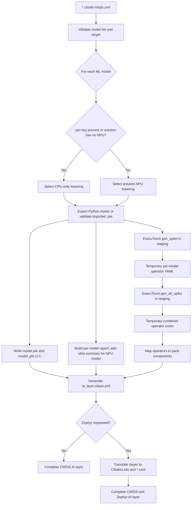
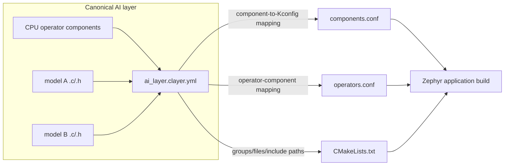
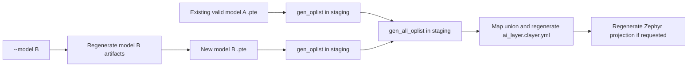

# TODO for Template Release

- Update CMSIS-Toolbox to version 2.16 once available.

- DONE: Expand support to both Zephyr-based and CMSIS-based workflows.

- DONE: Add Cortex-M-only targets alongside the existing Cortex-M/Ethos-U targets.


- Final directory structure should be:

  | Directory | Scope | Contents |
  | --- | --- | --- |
  | `cmsis-u55` | CMSIS Cortex-M/U55/U65 | Solution, layers, config |
  | `cmsis-u85` | CMSIS Cortex-M/U85 | Solution, layers, config |
  | `cmsis-m` | CMSIS Cortex-M | Solution, layers, config |
  | `zephyr-u55` | Zephyr Cortex-M/U55/U65 | Solution, app, config |
  | `zephyr-u85` | Zephyr Cortex-M/U85 | Solution, app, config |
  | `zephyr-m` | Zephyr Cortex-M | Solution, app, config |
  | `model_conversion` | Shared model-conversion tools | Scripts and tests |
  | `.venv` | Shared Python environment | Python packages |
  | `TinyCNN-model` | Shared integration model sources | Test models |


# TODO: Multiple models in one AI layer

## Summary

- One AI layer contains all ML models that run on a single CPU (processor),
  optionally with NPU acceleration.
- Each ML model is stored with its individual artifacts and separate `.pte`,
  `.c`, and `.h` files.
- The fallback operators that execute on the CPU are combined across all ML
  models in the generated `*.clayer.yml`.
- Zephyr export is an optional operation that primarily uses the generated
  `*.clayer.yml` as input.
- `create_ai_layer.py` creates the AI layer. Without `--model`, it converts all
  models; with `--model`, it updates only the selected model in that layer.

## Intended ownership and execution model

One AI `*.clayer.yml` describes one deployable AI layer containing one or more
ML models. The layer output consists of the serialized and embedded form of
each ML model plus one shared description of the runtime, backends, CPU
operators, and optional CMSIS-NN library required to execute all models. The
application links one ExecuTorch runtime and all model data arrays from that
layer.

An Ethos-U model does **not** run entirely on the CPU: delegated graph
segments run on the NPU, while graph boundaries and unsupported/fallback
operators run on the CPU. A Cortex-M-only model runs its operators on the
CPU, optionally using CMSIS-NN kernels. Therefore, operator and component
selection shall be computed from the union of the requirements of every
generated/imported `.pte` in the layer.

The following artifacts have different purposes and shall not be conflated:

- the generated `*.clayer.yml` is the persistent operator selection: every CPU
  operator is represented by one ExecuTorch operator component, together with
  the required runtime, backend, and CMSIS-NN components;
- per-model reports identify the CPU fallback operators required by each model
  and contain the Vela summary where applicable;
- Zephyr `CMakeLists.txt`, `operators.conf`, and `components.conf` are a derived
  translation of the generated `*.clayer.yml`, not an independent selection
  result; and
- Vela reports describe NPU compilation and are not operator selection input.

## Relevant upstream ExecuTorch scripts

Review against the ExecuTorch 1.5.1 scripts installed by this template:

- `python -m executorch.codegen.tools.gen_oplist` reads one `.pte` and writes a
  standard `selected_operators.yaml`, including operator names and available
  dtype/dimension-order kernel metadata. Use this as a temporary conversion
  step instead of scanning `.pte` bytes with regular expressions.
- `python -m executorch.codegen.tools.gen_all_oplist` reads a list of
  `selected_operators.yaml` files and combines them with TorchGen's
  `combine_selective_builders`. This is the correct upstream operation for the
  multi-model operator union and preserves kernel metadata and debug origin.
- `python -m executorch.codegen.tools.gen_max_kernel_num` accepts repeated
  operator-list YAML inputs and computes the shared runtime registry size. It
  may be useful when the pack exposes the generated registry-size header.
- `executorch.codegen.tools.merge_yaml` and the CMake `merge_yaml` wrapper merge
  optimized and fallback **kernel-definition** YAML with precedence. They do
  not merge the operator requirements of several ML models and shall not be
  used for that purpose.
- The CMake `gen_selected_ops` interface accepts only one model path. Calling
  `gen_oplist` once per model followed by `gen_all_oplist` is therefore the
  applicable upstream multi-model flow.

After the upstream union is produced, `create_ai_layer.py` remains responsible
for mapping selected operators to components supplied by the resolved
`PyTorch::ExecuTorch` pack and for rendering the CMSIS layer. All intermediate
`selected_operators.yaml` files, including the combined file, shall live only
in the generator's staging directory and shall not be installed in the AI
layer. Their persistent equivalent is the operator component list in
`*.clayer.yml`.

### Integration inside `model_conversion/create_ai_layer.py`

[`model_conversion/create_ai_layer.py`](model_conversion/create_ai_layer.py)
shall remain the only user-facing command. It orchestrates the upstream modules
internally; users do not run the operator tools as an additional build step.

`run_in_venv()` already restarts the generator with the workspace's pinned
Python environment. After that restart, import the upstream functions directly:

```python
from executorch.codegen.tools.gen_oplist import gen_oplist
from executorch.codegen.tools import gen_all_oplist
```

`gen_oplist` provides a callable API. `gen_all_oplist` exposes its merge through
`main(argv)`, so call that function with an explicit argument list. Do not start
another Python process and do not import its private helper functions.

The multi-model path in `create_ai_layer.py` shall then follow this structure:

```python
with generation_stage(layer_dir) as stage:
    model_yamls = []
    generated_models = []

    for model in models:
        execution = resolve_model_execution(model, mlops)
        pte, vela_report = export_or_import_model(model, execution)
        staged_pte = write_staged_model_files(stage, model, pte)

        model_yaml = stage / "operators" / model.name / "selected_operators.yaml"
        model_yaml.parent.mkdir(parents=True)
        gen_oplist(
            output_path=model_yaml,
            model_file_path=str(staged_pte),
        )
        model_yamls.append(model_yaml)
        generated_models.append(
            GeneratedModel(model, execution, staged_pte, model_yaml, vela_report)
        )

    model_list = write_operator_list_file(stage, model_yamls)
    union_dir = stage / "operators" / "all-models"
    union_dir.mkdir(parents=True)
    gen_all_oplist.main([
        "--model_file_list_path", f"@{model_list}",
        "--output_dir", str(union_dir),
    ])

    selected = read_selected_operators(union_dir / "selected_operators.yaml")
    operators = map_operators_to_pack_components(selected, executorch_pack)
    components = union_runtime_backend_and_operator_components(
        generated_models, operators
    )
    write_model_reports(generated_models, components)
    write_clayer(generated_models, components)
    write_zephyr_projection_from_clayer_if_requested()
    commit_stage_atomically()
```

Before importing these functions, the generator shall compare the installed
Python package version with the resolved `PyTorch::ExecuTorch` pack version and
fail clearly on a mismatch. Imports shall remain local to the post-`run_in_venv`
generation path so the initial host-Python invocation can still restart itself.

This replaces the current `components(pte, ...)` implementation, which searches
raw `.pte` bytes with a regular expression. Component mapping shall instead
consume the combined YAML `operators` keys, normalize namespaces/overloads, and
resolve each operator against the pack PDSC. An operator with no matching pack
component is a generation error rather than a warning.

The upstream YAML files remain inside `generation_stage`. Only the model
artifacts, reports, `*.clayer.yml`, and optional Zephyr projection are committed
to the AI-layer directory. Tests shall mock `gen_oplist` and
`gen_all_oplist.main` for unit coverage and include one integration test using
the pinned ExecuTorch package.

### Document the user-facing Python version contract

Treat [`model_conversion/requirements.txt`](model_conversion/requirements.txt)
as a user-facing configuration file, not only as an installer input. Improve
the model-conversion documentation to explain:

- that this file is the source of truth for the mutually compatible
  ExecuTorch, PyTorch, TorchAO, and Vela versions used by AI-layer generation;
- that the ExecuTorch Python version must match the resolved
  `PyTorch::ExecuTorch` pack version because the pack runtime consumes the
  generated `.pte` files;
- that `gen_oplist` and `gen_all_oplist` are supplied by the pinned ExecuTorch
  package and require no additional entry in either requirements file;
- that TorchGen is supplied by the pinned PyTorch package;
- why `requirements-arm-tosa.txt` is installed separately with `--no-deps` and
  is not the general version-selection file; and
- the update procedure: change the coordinated pins, the csolution pack pins,
  and compatibility documentation together, then run environment validation,
  model-conversion tests, and CMSIS/Zephyr build tests.

Add a short compatibility table to `model_conversion/README.md` and link to the
requirements files instead of duplicating their complete dependency lists.
Extend `setup_venv.py` validation to import `gen_oplist` and `gen_all_oplist` so
a future ExecuTorch wheel that omits these tools fails during environment setup
rather than during AI-layer generation.

## MLOps input

Extend the authored `mlops.model` node with an `input` sequence. CMSIS-Toolbox
currently emits this sequence as `cbuild-mlops.model.inputs`; the converter
shall consume the generated form. Confirm and document the final singular vs.
plural spelling against the CMSIS-Toolbox 2.16 schema before implementation.

```yaml
mlops:
  model:
    clayer: $AI-Layer$
    input:
      - name: TinyCNN
        file: ../model/model.py
        optimize: size    # specific vela parameter for this model
        parameters:
          input-shape: 1x16x16x3
          calibration-samples: 2
      - name: MyModel1
        file: ../model1/model.py
        cpu:              # run on CPU only
      - name: MyModel2
        file: ../model2/MyModel.pte    # input is a *.pte file
```

Requirements:

- `name` is required and unique, and is used for the layer group, output file
  stem, and C identifier after validation/sanitization;
- `file` is required and is resolved relative to the solution directory;
- Python sources are exported for the selected target; `.pte` files are copied
  as already-exported target-specific inputs and are still inspected for CPU
  operator requirements;
- the presence of an empty `cpu:` key selects CPU-only export for that model;
  test key presence rather than truthiness because YAML loads the empty value as
  `None`. The CPU type comes from `processor.type`;
- when `cpu:` is absent, the model is exported for the solution's NPU. If the
  solution has no NPU, CPU-only export is the only valid mode;
- an imported `.pte` follows the same resolution rule: `cpu:` or a solution
  without an NPU declares a CPU-only model; otherwise it declares an
  NPU-targeted model. The converter shall reject a `.pte` whose
  delegates/operators are inconsistent with that declaration or with the
  selected solution target;
- `parameters` is a mapping passed to the model entry point; unknown parameters
  fail with a model-qualified diagnostic rather than being silently ignored;
- `optimize` is a per-model Vela setting. It supplements the target-wide
  settings under `vela` and is rejected for resolved CPU-only execution;
- the existing scalar `model` form remains supported as the single-model
  compatibility form for one release cycle.

## Generated artifacts

The generated AI-layer directory is the complete output of
`create_ai_layer.py`:

```text
ai_layer/
|-- ai_layer.clayer.yml              # canonical build description
|-- <model-a>.pte                    # serialized ML model
|-- <model-a>_pte.c                  # embedded model data
|-- <model-a>_pte.h                  # model data declarations
|-- <model-a>_REPORT.md              # model conversion and optimization summary
|-- <model-b>.pte
|-- <model-b>_pte.c
|-- <model-b>_pte.h
|-- <model-b>_REPORT.md
|-- CMakeLists.txt                    # Zephyr projection, when requested
|-- components.conf                  # Zephyr projection, when requested
`-- operators.conf                   # Zephyr projection, when requested
```

For each model `<name>` (using its validated file stem and identifier), generate:

```text
<name>.pte
<name>_pte.c
<name>_pte.h
<name>_REPORT.md
```

`<name>_pte.c/.h` shall export unique `<name>_pte` and `<name>_pte_size`
symbols. `<name>_REPORT.md` shall be a concise, reproducible summary of how the
ML model was produced and optimized for execution on the target CPU/MCU and,
when applicable, NPU. It shall identify the model input used, record the
specific conversion parameters and effective optimization settings, list the
model's CPU fallback operators and whether CMSIS-NN is required, and distinguish
generated models from imported `.pte` inputs. For an Ethos-U model it shall
additionally contain the effective accelerator, system configuration, memory
mode, per-model Vela options, and Vela summary. A CPU-only model therefore has
a report but no Vela section.

Generate these layer-wide files from the union across all models:

```text
ai_layer.clayer.yml
CMakeLists.txt               # Zephyr only
components.conf              # Zephyr only
operators.conf               # Zephyr only
```

The `*.clayer.yml` shall contain one group per model with that model's C and
header files, one shared runtime component set, the union of CPU operator
components, and every backend required by at least one model. Thus a mixed
layer can contain CPU-only and Ethos-U models while selecting the Ethos-U
backend only once. Add `ARM::CMSIS-NN`/`CMSIS:NN Lib` if any selected CPU
operator requires CMSIS-NN. All lists shall be de-duplicated and sorted so
repeated generation is byte-for-byte stable. Zephyr shall attach all model C
files to `app` exactly once.

`ai_layer.clayer.yml` is the canonical build description. When Zephyr output is
requested, the Zephyr files shall be generated only by translating its content:

- layer groups and their `.c` files become `target_sources(app ...)`;
- the layer include paths become `target_include_directories(app ...)`;
- ExecuTorch runtime/backend components become `components.conf` selections;
  and
- ExecuTorch operator components become `operators.conf` selections.

The Zephyr conversion shall not inspect the `.pte` files or calculate another
operator union. This guarantees that CMSIS and Zephyr builds represent the same
AI layer.

## Full multi-model generation flow



The per-model branch may execute repeatedly, but aggregation and layer
generation happen once. The combined operator list is an internal intermediate;
its mapped operator components are written to `*.clayer.yml`. It does not
combine the ML models into one `.pte` file.

## AI-layer and Zephyr relationship



## Generation behavior

```text
python model_conversion/create_ai_layer.py <solution>.cbuild-mlops.yml
python model_conversion/create_ai_layer.py <solution>.cbuild-mlops.yml --model <name>
```

Without `--model`, regenerate every declared model and all layer-wide metadata.
With `--model`, regenerate only that model's per-model artifacts, then rebuild
the layer-wide union by running `gen_oplist` again on **all** declared `.pte`
artifacts. No persistent operator-list cache is required. Partial generation
shall fail without changing layer-wide files when another declared `.pte` is
missing, stale for a different target/export configuration, or cannot be
inspected. This prevents a partial run from silently dropping operators needed
by another model.



Stage per-model and layer-wide outputs before replacing destinations. On a
failed conversion, preserve the last complete layer. Remove obsolete generated
artifacts only when they are recorded in the previous generator manifest; do
not delete untracked/user files.

## Acceptance criteria

- Two models with overlapping CPU operators produce one copy of each runtime
  and operator component in both CMSIS and Zephyr metadata.
- A CPU-only model plus an Ethos-U model selects the CPU/CMSIS-NN requirements,
  the Ethos-U backend, and both model arrays.
- Two model arrays link without symbol collisions and can be selected by the
  application at run time.
- `--model <name>` retains the other models' operator requirements.
- Unknown model names, duplicate names, invalid identifiers, missing inputs,
  unsupported file types, and target-incompatible imported `.pte` files fail
  before replacing the complete layer.
- Reports distinguish CPU runtime operators from NPU-delegated work and are
  reproducible for identical inputs and tool versions.
# TODO for ExecuTorch compiler diagnostics

## Goal

Review ExecuTorch sources for correctness and portability, minimize warnings through
source fixes, and document remaining CMSIS/Zephyr configuration needs.

- Review existing `cproject.yml` suppressions; they hide findings documented in
  `et-warnings.md` without validating numerical, ABI, or portability impact.

Reference: [Compiler diagnostics](../cmsis-et-issues/et-warnings.md)

## ExecuTorch 1.6.0 Release

### Pack

- Add Zephyr integration folder; use generation script to generate the files.
- Apply fix for AC6 crash in `op_quantize.cpp`.
- Apply fix `<stddef.h>`/`<cstddef>` in `tag.h`; remove the `-includestddef.h` workaround.

### Zephyr Templates

- Add specific warning controls to minimize warnings; make it target-specific (for CMSIS-NN, Executorch); avoid global Zephyr suppressions.

## ExecuTorch 1.7.0

### Apply ExecuTorch sources changes

- Replace deprecated `optional` aliases; remove `-Wno-deprecated-declarations` from CMSIS and Zephyr templates.
- Find operators requiring IEEE NaN/Inf behavior, test them, or configure AC6 full FP compliance, and remove `-Wno-nan-infinity-disabled`.
- Fix mixed float/double expressions in quantize/dequantize; retain `-Wdouble-promotion` during qualification.
- Validate negative sizes and use consistent size types; retain `-Wall`/`-Wsign-compare`.
- Move or instantiate LLVM-reported unused header helpers; do not add global `-Wno-unused-function`.
- Fix the AC6 `op_quantize.cpp` crash, test all optimization levels on AC6 and LLVM.
- Verify GCC C++ ABI compatibility; retain scoped `-Wno-psabi` only when the informational note cannot be eliminated.
- Include `<stddef.h>`/`<cstddef>` in `tag.h`; remove the `-includestddef.h` workaround.
- Fix the CMSIS-NN MVE intrinsic type mismatch; remove scoped  `-Wno-incompatible-pointer-types`.

## Zephyr Integration issues

- Fix duplicate `libethosu_core_driver.a` emission in Zephyr's ArmClang link command.
- Fix orphan sections and RWX segments with explicit linker placement and permissions; never suppress these warnings.
- Ensure `model_pte.c` belongs to Zephyr `app` exactly once; never use weak definitions to hide duplicate symbols.

## Template configuration

- CMSIS: put temporary controls in `project.misc` with `for-compiler`; keep FP-mode choices separate from diagnostic suppressions.
- Zephyr: use target/source `target_compile_options` with language/compiler expressions; do not mute application or unrelated modules.
- Every warning suppression needs scope, reason, owner, upstream issue, removal condition, and CMSIS/Zephyr documentation.
