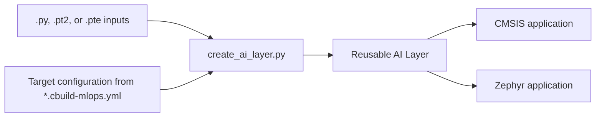

# ML model to ExecuTorch program conversion

`model_conversion/create_ai_layer.py` reads target configuration, model inputs,
and output locations from a CMSIS-Toolbox `*.cbuild-mlops.yml` file. It converts
Python model sources, lowers quantized `.pt2` archives, or validates existing
target-specific `.pte` programs. The result is a reusable AI Layer for one CPU,
optionally with Ethos-U acceleration. The same layer can be integrated into a
CMSIS or Zephyr application for that target.



[CMSIS-Toolbox MLOps integration](https://open-cmsis-pack.github.io/cmsis-toolbox/build-overview/#mlops-integration)
describes how the `*.cbuild-mlops.yml` file is generated.

## Set up the environment

Run the appropriate wrapper from the repository root.

Linux and macOS:

```console
./model_conversion/setup_venv.sh
```

Windows:

```console
.\model_conversion\setup_venv.bat
```

The setup creates `.venv` in the repository root and installs the pinned,
compatible ExecuTorch, PyTorch, TorchAO, and Vela versions. The installed
ExecuTorch Python version is written to the generated AI layer and reports as
the required
[`PyTorch::ExecuTorch`](https://www.keil.arm.com/packs/executorch-pytorch/overview/)
pack version. The converter does not require an installed CMSIS pack.

Use `--recreate` to rebuild an existing environment. The optional `--uv`
argument uses Python 3.13 by default; add `--python VERSION` to select another
supported version:

```console
./model_conversion/setup_venv.sh --uv --python 3.13 --recreate
```

## Convert models

Pass the generated MLOps file:

```console
cbuild setup cmsis-u85/cmsis-u85.csolution.yml --active SSE-320-U85 --packs      # create *.cbuild-mlops.yml
python model_conversion/create_ai_layer.py cmsis-u85/cmsis-u85.cbuild-mlops.yml  # create ExecuTorch programs
cbuild cmsis-u85/cmsis-u85.csolution.yml --active SSE-320-U85                    # build application
```

The `--active SSE-320-U85` option enables that CMSIS-Toolbox target-set for
both setup and build.

`create_ai_layer.py` automatically restarts itself with the `.venv` interpreter
when necessary. It finds `.venv` in the repository root and resolves model
inputs, Vela configuration, and `mlops.model.clayer` relative to the directory
containing the supplied `*.cbuild-mlops.yml` file. It does not read other
CMSIS-Toolbox output files.

Without additional options, every declared input is processed. To update one
input while retaining the others, use:

```console
python model_conversion/create_ai_layer.py cmsis-u85/cmsis-u85.cbuild-mlops.yml --input TinyCNN
```

The selected input is processed again. The generator then inspects every
declared `.pte` program file and rebuilds the layer-wide fallback-operator
union and metadata. A per-input report is output only; it is never
operator-selection input.

## Input

For an Ethos-U target, the `*.cbuild-mlops.yml` file provides the `npu:` and
`vela:` configuration described in the
[CMSIS-Toolbox MLOps documentation](https://open-cmsis-pack.github.io/cmsis-toolbox/YML-Input-Format/#mlops-management).
For a CPU-only target, omit `npu:`. On a mixed target, an empty `cpu:` key in an
input entry selects CPU lowering for that input. Accelerator, system
configuration, and memory mode are shared by every Ethos-U program in the
layer.

Declare inputs under `mlops.model.input` in the `*.csolution.yml` file.
CMSIS-Toolbox writes the generated form as `cbuild-mlops.model.input`:

```yaml
mlops:
  model:
    clayer: $AI-Layer$
    input:
      - name: TinyCNN
        file: ../model/TinyCNN/TinyCNN.py
        optimize: size
        parameters:
          input-shape: 1x16x16x3
          calibration-samples: 2
      - name: CpuModel
        file: ../models/cpu-model.pt2
        cpu:
      - name: ImportedModel
        file: ../models/imported.pte
```

### `mlops.model`

| Key | Requirement | Description |
|:---|:---|:---|
| `clayer:` | Required | Path and filename of the `*.clayer.yml` file generated for both CMSIS and Zephyr. Its parent directory receives all generated artifacts. |
| `zephyr:` | Zephyr only | Generates additional Zephyr integration files in the directory containing `clayer`. |
| `input:` | Required | Sequence of input-artifact definitions. |

`clayer:` is required in every configuration. For Zephyr, keep `clayer:` and
add `zephyr:` alongside it:

```yaml
model:
  clayer: ai_layer/ai_layer.clayer.yml
  zephyr:               # generate Zephyr integration files
  input:
    - name: TinyCNN
      file: ../model/TinyCNN/TinyCNN.py
```

The Zephyr csolutions define `AI-Layer` as
`$SolutionDir()$/ai_layer/ai_layer.clayer.yml` in each target's variables and
use `clayer: $AI-Layer$` under `mlops.model`, matching the CMSIS templates.
CMSIS-Toolbox resolves this to the file path in the generated MLOps metadata.

The `mlops.model.input` node contains a list of named input artifacts.

| `input:` | Requirement | Description |
|:---|:---|:---|
| `- name:` | Required | Unique C identifier used for the layer group, filenames, and embedded-array symbol. |
| &nbsp;&nbsp;&nbsp;`file:` | Required | `.py`, `.pt2`, or `.pte` file relative to the directory containing `*.cbuild-mlops.yml`. The file extension selects the workflow. |
| &nbsp;&nbsp;&nbsp;`cpu:` | Optional | Presence selects CPU lowering for `.py` and `.pt2`, or asserts CPU-only execution for `.pte`. The CPU type comes from `processor.type`. |
| &nbsp;&nbsp;&nbsp;`optimize:` | Optional | Per-input Vela optimization setting for NPU-resolved `.py` and `.pt2`; invalid for CPU-resolved inputs and `.pte`. |
| &nbsp;&nbsp;&nbsp;`parameters:` | Optional | `.py` only. Mapping passed to accepting Python workflow functions. `input-shape` and `calibration-samples` are converted to Python-friendly names and types. |

The file extension selects the processing workflow:

| Input | Role | `create_ai_layer.py` action |
|:---|:---|:---|
| `.pt2` | Recommended: lowering input | Validate, backend-lower, serialize as `.pte`, and integrate. |
| `.pte` | Optional: prebuilt deployment artifact | Inspect, validate, and integrate unchanged. |
| `.py` | Convenience: model-production input | Export, quantize, backend-lower, serialize, and integrate. |

An input file is a container boundary, not necessarily one model. Each input
file has its own output `.pte` container. A `.pt2` may contain several
named, exported PyTorch programs; they become named methods in that output.
Separate input entries are not implicitly combined.

### `.pt2` input

Use a `.pt2` file when the model has already been exported and quantized.
`create_ai_layer.py` lowers it for the target selected by the solution and
generates the deployable `.pte` program. It does not quantize the model again.

A `.pt2` archive may contain one or more named programs. These become methods
in the generated `.pte`.

The [TinyCNN example](../model/TinyCNN/README.md) shows how to generate and use
a `.pt2` input:

```powershell
.venv/Scripts/python.exe model/TinyCNN/quantize_TinyCNN.py
```

Producers that need to expose runtime constants can include
`constant_methods.json`; see the
[formal `.pt2` contract](model_conversion-specification.md#pt2-input).

### `.pte` input

This optional workflow integrates a prebuilt deployment artifact. The program
is deserialized and its methods, delegates, and Ethos-U compile specification
are checked against the selected target. It is integrated unchanged and is
never passed through Vela or another lowering pass. Invalid, portable-only NPU,
unknown-backend, or target-mismatched programs are rejected.

### `.py` input

This convenience workflow performs export, built-in quantization, lowering,
and serialization. The module must define:

- `get_model(...) -> torch.nn.Module`;
- `get_example_inputs(...) -> (args, kwargs)`; and
- `get_calibration_inputs(...) -> [(args, kwargs), ...]`.

Example inputs define the export signature and are deliberately separate from
representative PTQ calibration cases. Both positional and keyword inputs are
supported. Use `.pt2` for custom quantization, QAT, specialized calibration, or
producer-owned accuracy validation.

## Output

The script writes all generated files to the directory containing the required
`mlops.model.clayer` path. For example,
`clayer: ai_layer/ai_layer.clayer.yml` writes the artifacts to `ai_layer/`.

```text
<clayer-directory>/
|-- <clayer-name>.clayer.yml         # layer description for CMSIS and other tools
|-- <name-a>.pte                     # backend-lowered program validated for target
|-- <name-a>_pte.c                   # embedded program data
|-- <name-a>_pte.h                   # program data declarations
|-- <name-a>_REPORT.md               # processing, lowering, and validation summary
|-- <name-b>.pte
|-- <name-b>_pte.c
|-- <name-b>_pte.h
|-- <name-b>_REPORT.md
|-- CMakeLists.txt                   # Zephyr: model sources and include directory
|-- components.conf                  # Zephyr: runtime and backend Kconfig settings
`-- operators.conf                   # Zephyr: required CPU operator Kconfig settings
```

For each input `<name>`, the script creates:

- `<name>.pte`, the serialized ExecuTorch program;
- `<name>_pte.c` and `<name>_pte.h`, exporting unique embedded-array symbols;
  and
- `<name>_REPORT.md`, recording the input, conversion parameters, optimization,
  CMSIS-NN requirement, required ExecuTorch pack version, CPU fallback
  operators, and applicable Vela output. Its sections appear in this order:
  Input report, Required ExecuTorch version, CPU fallback operators, and Vela
  report when applicable.

The generator replaces the files produced by the current run. It does not
delete other files from the output directory; obsolete artifacts from removed
inputs can be deleted by the user explicitly.

The script always creates the `*.clayer.yml` file specified by
`mlops.model.clayer`. It contains one group per input and selects the shared
ExecuTorch runtime, required backends, and the union of CPU fallback operators
extracted from all `.pte` files. CPU-only layers omit the Ethos-U backend;
CMSIS-NN is selected when a fallback operator requires it.

When `mlops.model.zephyr` is present, the script additionally creates
`CMakeLists.txt`, `components.conf`, and `operators.conf`. These files and the
`*.clayer.yml` file are generated from the same validated AI Layer data.

Add the generated configuration fragments before Zephyr processes the
configuration, then add the AI-layer directory after creating the application:

```cmake
# Select the AI Layer's Kconfig fragments before Zephyr processes configuration.
list(APPEND EXTRA_CONF_FILE
  "${CMAKE_CURRENT_SOURCE_DIR}/ai_layer/components.conf"
  "${CMAKE_CURRENT_SOURCE_DIR}/ai_layer/operators.conf"
)

find_package(Zephyr REQUIRED HINTS $ENV{ZEPHYR_BASE})
project(zephyr_m)

add_subdirectory(ai_layer)
```

All output files use LF line endings where applicable. The generated
`*.cbuild-mlops.yml` input is never modified.

## Troubleshooting

### A global `PYTHONPATH` overrides the repository environment

A global `PYTHONPATH` that contains another Python installation's
`site-packages` directory is placed before `.venv/Lib/site-packages` on
`sys.path`. The converter may then load incompatible global packages even
though it is running with the repository's `.venv` interpreter. This can cause
import errors such as a missing symbol from `typing_extensions`.

Check which copy is being imported:

```console
.venv/Scripts/python -c "import typing_extensions; print(typing_extensions.__file__)"
```

On Windows PowerShell, remove `PYTHONPATH` only from the current shell before
running the converter:

```powershell
Remove-Item Env:PYTHONPATH -ErrorAction SilentlyContinue
python model_conversion/create_ai_layer.py <solution>.cbuild-mlops.yml
```

On Linux or macOS, clear it only for the converter command:

```sh
PYTHONPATH= python model_conversion/create_ai_layer.py <solution>.cbuild-mlops.yml
```

The global setting can remain available in other shells for documentation or
repository-specific tooling.

## Update the ExecuTorch version

The exact `executorch==<version>` pin in `requirements.txt` is the version
authority. The converter records that version in every generated AI layer and
report, and fails if the active Python environment does not contain the same
`executorch` distribution version. CMSIS projects obtain the matching runtime
pack from the generated layer; they do not select it separately in the
csolution.

1. Update the coordinated Python versions in `requirements.txt`. Use the
   ExecuTorch release's `torch_pin.py` and `install_requirements.py` as the
   source of truth for compatible `executorch`, `torch`, and `torchao`
   versions. Update `requirements-arm-tosa.txt` only when the corresponding
   ExecuTorch Arm backend requirements change.

2. For every Zephyr solution, update its exact `PyTorch::ExecuTorch` pack pin
   to the same compatible release. Zephyr needs this separate selection because
   the pack supplies the external Zephyr module; the converter does not compare
   the two versions.

3. Recreate the repository environment:

   ```console
   ./model_conversion/setup_venv.sh --recreate
   ```

   On Windows, use `model_conversion\setup_venv.bat --recreate`.

4. Regenerate the AI Layer and then build its application:

   ```console
   cbuild setup <solution>.csolution.yml --active <target-set> --packs
   python model_conversion/create_ai_layer.py <solution>.cbuild-mlops.yml
   cbuild <solution>.csolution.yml --active <target-set>
   ```

5. Review the regenerated `*.clayer.yml`, program data, operator selection,
   and reports. Run the converter tests and the CMSIS and Zephyr FVP workflows
   before accepting the update.

[`PyTorch::ExecuTorch`](https://www.keil.arm.com/packs/executorch-pytorch/overview/)
shows the current pack version with release information.

## Development and tests

The [model-conversion toolset specification](model_conversion-specification.md)
defines the deliverables and behavioral contracts implemented by the toolset.

Run the unit tests from the repository root:

```console
python -m unittest discover -s model_conversion/test -p "test_*.py" -v
```

Most tests mock model export and do not require Torch or Vela. An
environment-backed PTE validation test is skipped by a host interpreter without
ExecuTorch; run the suite with `.venv/Scripts/python.exe` on Windows or
`.venv/bin/python` on Linux/macOS to generate real portable and Ethos-U PTE
files and exercise malformed and target-mismatch rejection. No test requires an
FVP or target hardware.

## References

- [PyTorch `torch.export`](https://docs.pytorch.org/docs/stable/export)
- [PyTorch export serialization](https://docs.pytorch.org/docs/stable/user_guide/torch_compiler/export.html#serialization)
- [PT2 Archive Specification](https://docs.pytorch.org/docs/main/user_guide/torch_compiler/export/pt2_archive.html)
- [ExecuTorch model export and lowering](https://docs.pytorch.org/executorch/stable/using-executorch-export.html)
- [ExecuTorch quantization overview](https://docs.pytorch.org/executorch/stable/quantization-overview.html)
- [ExecuTorch Ethos-U quantization](https://docs.pytorch.org/executorch/stable/backends/arm-ethos-u/arm-ethos-u-quantization.html)
